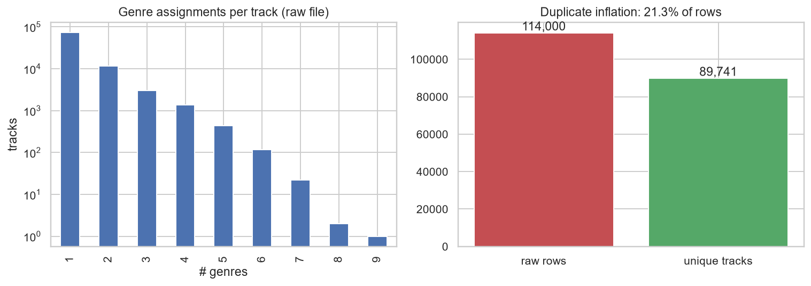
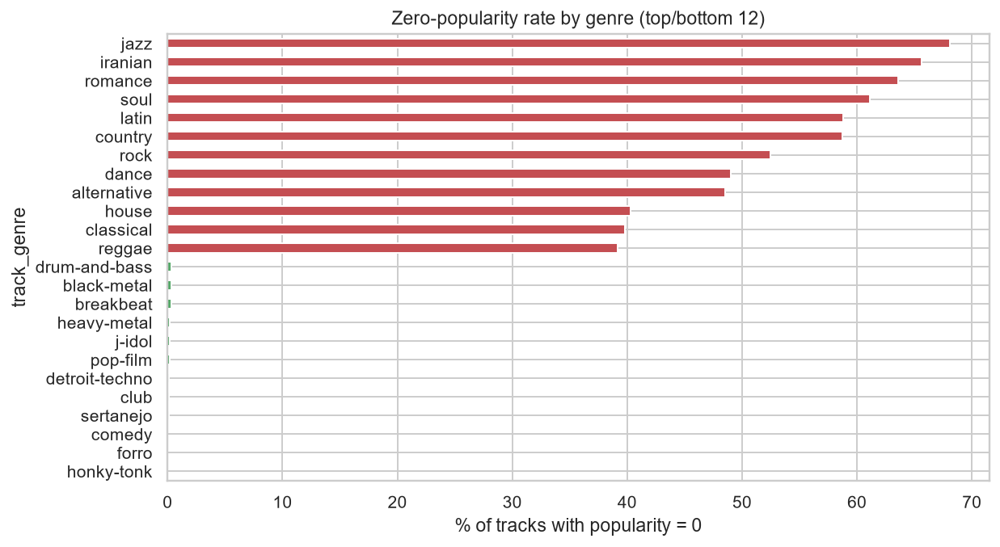
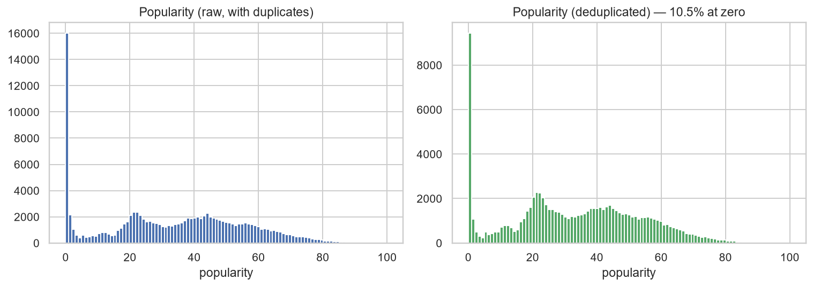
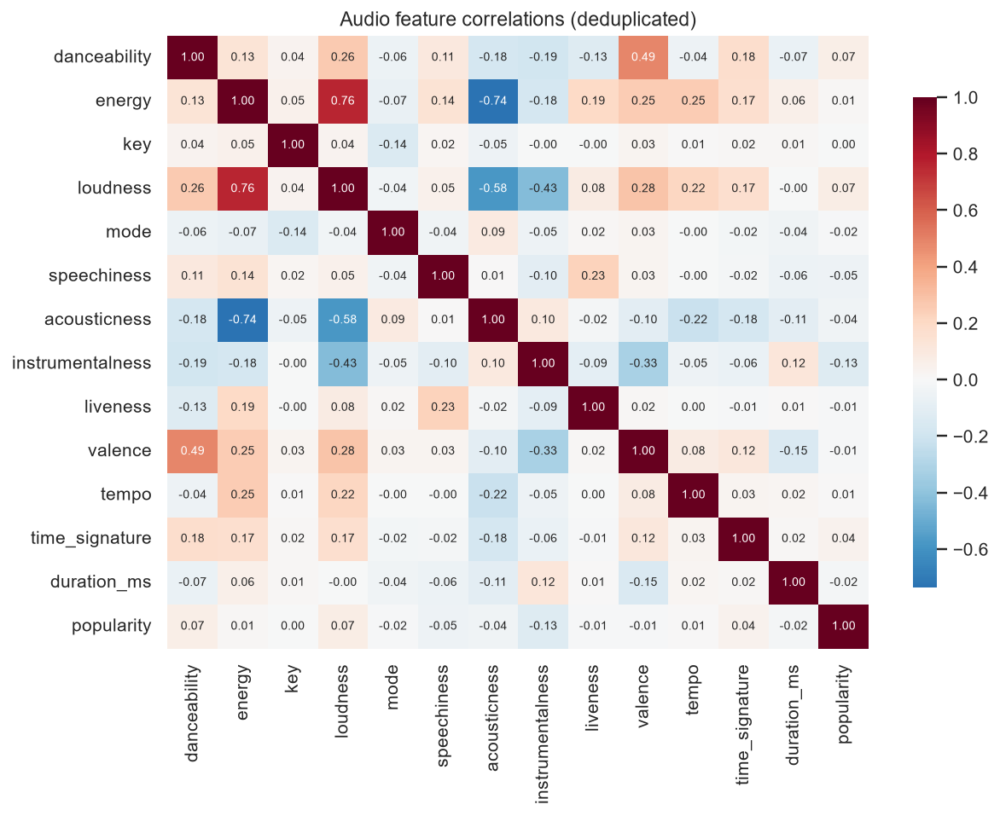
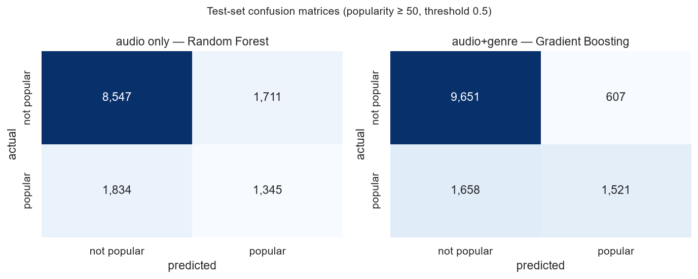
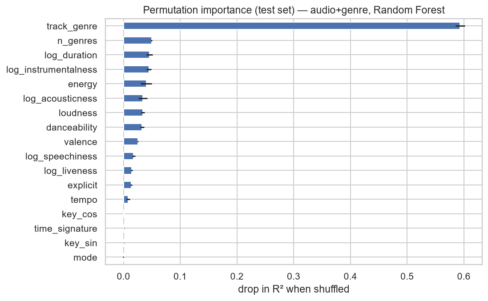
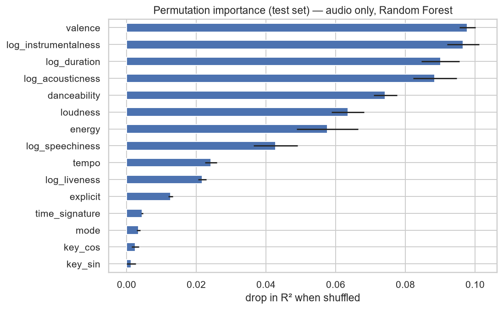
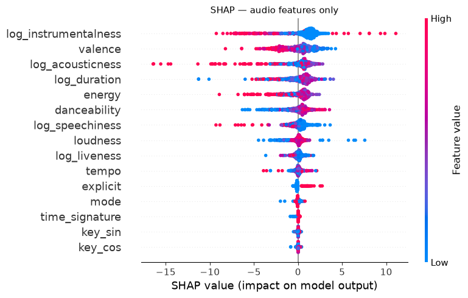
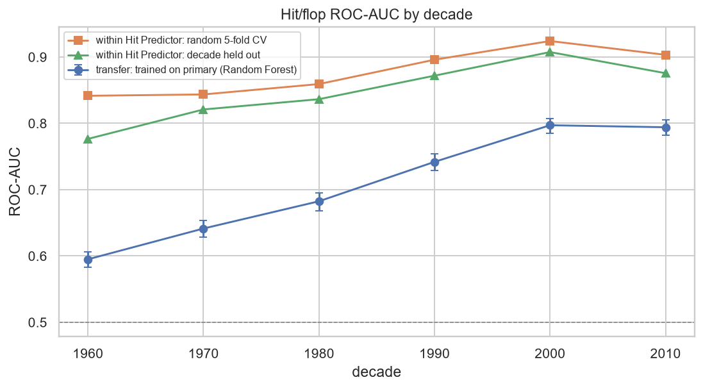
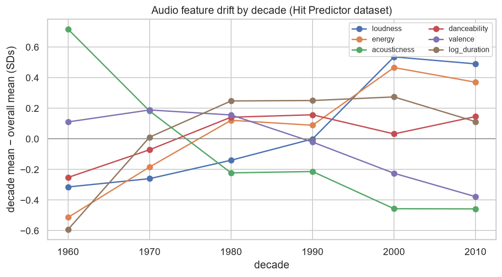

# Predicting Song Popularity on Spotify Using Audio Features

**Predictive Analytics — Course Project**
Data accessed 20 August 2026 · `dataset.csv` SHA-256 `b202fa49909b2d5c…721177bd`

---

## 1. Introduction

Streaming platforms describe every track with a set of numeric audio descriptors —
danceability, energy, valence, acousticness and so on. A natural question follows: does
the measurable character of a recording explain how popular it becomes?

This study treats that as an empirical question rather than an engineering target. Spotify's
popularity score is a recency-weighted function of play counts, and play counts are driven
by artist reputation, playlist placement and promotional spend — none of which is audible in
the waveform. The interesting result is therefore not the highest achievable accuracy but the
**ceiling**: how far audio features actually go, and where the remaining signal lives.

**Research questions**

| | |
|---|---|
| **RQ1** | How much variance in popularity is explained by audio features alone? |
| **RQ2** | Which audio features carry that signal, and in which direction? |
| **RQ3** | Does genre context materially improve on audio features alone? |
| **RQ4** | Is popularity easier to predict as a binary outcome than as a continuous score? |

## 2. Background and data provenance

On **27 November 2024** Spotify deprecated the `audio_features` and `audio_analysis` Web API
endpoints, along with recommendations and related-artists. Only applications holding a quota
extension granted before that date retain access; new applications receive `403`/`410`, and
no official replacement has been published since.

This has a direct methodological consequence: **the data for this study could not be
collected first-hand.** The analysis uses an archived pre-deprecation snapshot, and every
conclusion is therefore conditional on a dataset frozen at scrape time. This is stated here
rather than buried, because it bounds what the study can claim (§9).

**Dataset.** The Spotify Tracks Dataset (114,000 × 21, BSD licensed), obtained from its
HuggingFace mirror. Columns comprise track identifiers and metadata, the 11 Spotify audio
features, `duration_ms`, `explicit`, `track_genre`, and the target `popularity` (0–100).

## 3. Exploratory findings

Three properties of the raw file shaped every subsequent decision.

### 3.1 The file is not 114,000 independent observations

The dataset is constructed as **114 genres × 1,000 tracks**. Because a track can belong to
several genres, the same `track_id` recurs across rows:

| | |
|---|---|
| Raw rows | 114,000 |
| Unique `track_id` | 89,741 |
| Duplicate rows | **24,259 (21.3%)** |
| Tracks appearing in ≥ 2 genres | 16,641 |
| Maximum genres for one track | 9 |



A train/test split performed on the raw file places **the same song in both partitions**,
which inflates every reported score. Deduplication before splitting is therefore not
housekeeping — it is the difference between a valid and an invalid experiment. This is the
most consequential single decision in the study.

### 3.2 The target is zero-inflated, and the zeros are not random

14.1% of raw rows (10.5% after deduplication) sit at exactly `popularity = 0`. Critically,
these zeros are **clustered by genre** rather than scattered:

| Genre | % at zero | | Genre | Mean popularity |
|---|---|---|---|---|
| jazz | 68.1% | | pop-film | 59.3 |
| iranian | 65.6% | | k-pop | 56.9 |
| romance | 63.6% | | chill | 53.7 |
| soul | 61.1% | | … | |
| latin | 58.8% | | romance | 3.2 |
| country | 58.7% | | iranian | 2.2 |



Clustering of this kind is not plausibly a musical fact — jazz is not 68% unlistenable. It
points to **regional licensing or availability gaps at scrape time**: a different data-
generating process from the popularity score itself. A single regressor is forced to average
across both processes, which motivates the hurdle model in §5.



### 3.3 Linear associations with the target are negligible

No audio feature correlates with popularity above |r| = 0.10. The strongest is
`instrumentalness` at −0.095.



The heatmap also shows the expected internal structure: `energy` and `loudness` move together
and both oppose `acousticness`. Formal variance-inflation testing confirms it —
`tempo` **15.3**, `energy` **14.6**, `danceability` **12.2**, all beyond the conventional
threshold of 10. Linear coefficients on these features cannot be read as independent effects,
which is why regularised and tree-based models carry the analysis.

## 4. Methodology

**Preparation.** Deduplicate on `track_id`, retaining the first genre and recording
`n_genres` as a feature; drop 163 physically impossible records (`tempo = 0`,
`time_signature = 0`, zero duration). Final analysis set: **89,578 unique tracks**.

**Feature engineering.** `log1p` transforms for the four heavily skewed features
(`speechiness`, `instrumentalness`, `liveness`, `acousticness`); duration converted to
minutes and logged. Musical `key` is **cyclic** — key 11 is adjacent to key 0 — so it is
projected onto the unit circle as `sin`/`cos` pairs rather than encoded as an ordinal, which
would assert a distance that does not exist.

**Splitting.** 70/15/15 train/validation/test, stratified on binned popularity so the zero
spike is represented consistently across partitions. Hyperparameters were tuned on train,
models were selected on validation, and the chosen models were refitted on train +
validation before the single test evaluation.

**Hyperparameter tuning.** Every model's settings were chosen by 3-fold cross-validation
**inside `train.csv` only** (`src/tuning.py`); the validation and test partitions are never
loaded by the search. Regression was scored on R², classification on average precision. Ridge,
Lasso and Logistic Regression were grid-searched over their regularisation strength; Random
Forest (8 candidates) and Gradient Boosting (12 candidates) used randomised search. Each
candidate is the full `Pipeline`, so preprocessing is refitted inside every fold. Forests were
searched with 60 trees and refitted with 300.

The search was deliberately light — its purpose is to show the reported numbers are not an
artefact of arbitrary settings, not to chase leaderboard accuracy — and it shows. **Gradient
Boosting chose values at the edges of its grid** in all four searches: the smallest
`min_samples_leaf` (10), the largest `max_leaf_nodes` (127) and `l2_regularization` (1.0), the
shorter `max_iter` (300), and in three of four the smallest learning rate (0.03).
**Audio+genre Logistic Regression likewise chose C = 100**, the top of its 10⁻³–10² grid (the
audio-only version chose the bottom, C = 0.001), and audio+genre Lasso chose the smallest
α offered. For these models the true optimum may lie outside the grid, so their tuned scores
are conservative. This does not touch the headline regression results: Random Forest won on
validation in both feature sets, and its chosen settings (fully grown trees, unrestricted
depth) sit at the natural limit of the model rather than an arbitrary cut-off.

**Test-set disclosure.** The test set was scored once before, for the DA1 proposal, using the
untuned models (R² 0.255 audio only, 0.483 audio+genre). The results in §6 come from a second
scoring after tuning. No setting — hyperparameter, model choice, feature set or threshold —
was chosen by looking at those DA1 test numbers: tuning saw only `train.csv`, and model
selection saw only validation.

**Leakage controls.** All preprocessing sits inside a `sklearn.Pipeline`, so scalers and
encoders are fitted per fold and never see held-out data. Three assertions verify that no
`track_id` appears in more than one partition. Artist-level features were deliberately
excluded: artist mean popularity is the strongest available predictor, but computing it
across the dataset leaks the target, and defending it properly would require artist-grouped
splits. Excluding it keeps the study faithful to its title.

## 5. Models

| Model | Role |
|---|---|
| Mean predictor | Trivial baseline; all R² measured against it |
| Linear Regression | Interpretable coefficients |
| Ridge / Lasso | Handles the collinearity documented in §3.3 |
| Random Forest | Non-linear, captures interactions |
| Gradient Boosting (`HistGradientBoosting`) | Expected strongest |
| **Hurdle (two-stage)** | Classify zero vs non-zero, then regress on non-zero; addresses §3.2 |

Each was fitted on two feature sets — **audio only** and **audio + genre** — so the
contribution of genre context (RQ3) is directly measurable.

> **Note on the hurdle model.** It is defined only where a zero mass exists. In the
> zero-excluded sensitivity analysis the stage-1 classifier would train on a single class and
> emit degenerate probabilities, so the model is skipped there rather than reported. An
> earlier run that did not guard this produced R² = −4.18 — an artefact, not a result.

## 6. Results

### 6.1 Regression — validation

| Features | Model | R² | RMSE | MAE |
|---|---|---|---|---|
| audio only | Mean baseline | 0.000 | 20.58 | 17.24 |
| audio only | Linear Regression | 0.037 | 20.20 | 16.64 |
| audio only | Random Forest | **0.255** | 17.77 | 13.64 |
| audio only | Gradient Boosting | 0.188 | 18.55 | 14.81 |
| audio only | Hurdle (2-stage) | 0.200 | 18.41 | 14.62 |
| audio+genre | Linear Regression | 0.337 | 16.76 | 12.01 |
| audio+genre | Random Forest | **0.499** | 14.57 | 9.88 |
| audio+genre | Gradient Boosting | 0.469 | 15.00 | 10.33 |
| audio+genre | Hurdle (2-stage) | 0.471 | 14.98 | 10.27 |

Random Forest is the validation winner in both feature sets and is the model carried to the
test set. The hurdle model edges out plain Gradient Boosting, but by little.

### 6.2 Regression — held-out test set

| Features | Model | R² | Adj. R² | RMSE | MAE |
|---|---|---|---|---|---|
| audio only | Mean baseline | 0.000 | −0.001 | 20.64 | 17.31 |
| audio only | Linear Regression | 0.034 | 0.033 | 20.28 | 16.72 |
| audio only | **Random Forest** | **0.266** | 0.265 | 17.68 | 13.57 |
| audio+genre | Linear Regression | 0.324 | 0.323 | 16.97 | 12.16 |
| audio+genre | **Random Forest** | **0.501** | 0.500 | 14.58 | 9.92 |

**Seed variance.** To check that these figures are not an accident of one partition, the tuned
Random Forest was refitted on five train/validation partitions (seeds 42, 1–4;
`src/run_seed_variance.py`). Only the 85% pool shared by train and validation was
re-partitioned, at the same sizes and strata; the test set stayed fixed and was not scored
again.

| Features | Validation R² (mean ± SD, 5 seeds) | Range |
|---|---|---|
| audio only | 0.250 ± 0.013 | 0.232–0.267 |
| audio+genre | 0.498 ± 0.009 | 0.491–0.513 |

The gain from genre (about 0.25) is roughly twenty times the seed-to-seed spread, and the
single-split validation scores in §6.1 (0.255, 0.499) sit inside both ranges.

### 6.3 Sensitivity: excluding zero-popularity tracks

| Features | Model | R² |
|---|---|---|
| audio only | Random Forest | 0.209 |
| audio+genre | Random Forest | 0.520 |
| audio+genre | Gradient Boosting | **0.522** |

Removing the zero mass *raises* the audio+genre ceiling (Random Forest 0.499 → 0.520) while
*lowering* audio-only performance (0.255 → 0.209). The zeros were partly predictable from
audio characteristics — consistent with them marking a distinct availability process — but
they add noise to the genre-informed model.

### 6.4 Classification (RQ4)

Threshold: 75th percentile of non-zero popularity (`popularity ≥ 50`), 23.7% positive. The
classifier for each feature set was selected on validation PR-AUC; results below are on the
held-out test set.

| Features | Model | ROC-AUC | PR-AUC | Precision | Recall | F1 | PR baseline |
|---|---|---|---|---|---|---|---|
| audio only | Random Forest | 0.724 | 0.435 | 0.440 | 0.423 | 0.431 | 0.237 |
| audio+genre | Gradient Boosting | **0.873** | **0.687** | 0.715 | 0.479 | 0.573 | 0.237 |



At the default 0.5 cut-off the audio-only model flags 3,056 tracks, of which 1,345 are
popular; the audio+genre model flags 2,128 with 1,521 correct, but still misses 1,658 of the
3,179 popular tracks. Genre buys precision far more than recall.

A sensitivity check at the 90th percentile (`≥ 61`, 9.9% positive) preserves the ordering
(validation ROC-AUC 0.736 → 0.887). The binary framing looks stronger, but this is partly
presentational: ROC-AUC 0.72 from audio alone corresponds to the same weak underlying signal
as R² 0.27. Discretising the target discards information and makes a modest relationship look
more decisive than it is.

## 7. Interpretation

**Permutation importance (test set), audio + genre:**

| Feature | Δ R² when shuffled |
|---|---|
| **`track_genre`** | **0.594** |
| `n_genres` | 0.049 |
| `log_duration` | 0.046 |
| `log_instrumentalness` | 0.045 |
| `energy` | 0.040 |



Genre (0.594) is roughly **thirteen times** more important than the strongest audio feature,
`log_duration` (0.046). `n_genres` ranks second overall, but it is a by-product of how the
dataset was built — the number of genre lists a track appears in — not an audio feature, so
it is left out of the comparison. This is the central empirical finding of the study.

**Within audio features only**, permutation importance and SHAP agree on which four features
matter, though not on their exact order:

| Rank | Permutation | SHAP (mean \|value\|) |
|---|---|---|
| 1 | `valence` (0.098) | `log_instrumentalness` (1.91) |
| 2 | `log_instrumentalness` (0.097) | `valence` (1.37) |
| 3 | `log_duration` (0.090) | `log_acousticness` (1.30) |
| 4 | `log_acousticness` (0.088) | `log_duration` (1.09) |





The four permutation scores lie within 0.01 of each other, so their order is not meaningful;
the set is. Direction (RQ2): instrumentalness and acousticness both push predicted popularity
**down** — vocal, produced tracks score higher. Key and mode are effectively inert (SHAP 0.05
for key, 0.11 for mode; permutation below 0.004), which is worth stating plainly: **the musical
key of a song carries no information about its popularity.** Tempo and time signature are
similarly minor.

The two methods agreeing matters, because permutation importance is the more trustworthy of
the two under the collinearity documented in §3.3 — impurity-based importances inflate
correlated features.

## 8. External validation and the era confound

The primary dataset carries no release year, so two questions could not be answered inside
it: does the audio signal generalise beyond Spotify's own popularity score, and how much of
it is really a proxy for *when* a track was made?

**Data.** *The Spotify Audio Features Hit Predictor Dataset (1960–2019)* (F. Ansari,
4TU.ResearchData, DOI 10.4121/uuid:d77e74b0-66bc-47ac-8b25-5796d3084478, GPL-3.0) gives about
41,000 tracks with the same Spotify audio features, a decade, and an independent Billboard-based
hit/flop label. The download is MD5-checked. **3,100 tracks also present in the primary
dataset were removed** — 1,922 by Spotify ID and 1,178 more by normalised artist + title,
since re-releases receive new IDs — so no track scored here was seen in training. The final
external set is **37,431 tracks** with a 47.5% hit rate. It has no `explicit` flag, so the
models in this section use the audio features without it.

### 8.1 Transfer

The validation-selected audio-only classifier (Random Forest, tuned settings) was trained on
the primary train + validation data at `popularity ≥ 50` — the primary test set was not
touched — and scored against the Hit Predictor label. The targets differ, so this tests
whether the *direction* of the audio signal generalises, not whether the scores match.

| Decade | Tracks | Hit rate | ROC-AUC | 95% CI |
|---|---|---|---|---|
| **All** | 37,431 | 0.475 | **0.691** | 0.686–0.695 |
| 1960s | 8,301 | 0.486 | 0.595 | 0.583–0.606 |
| 1970s | 7,319 | 0.480 | 0.641 | 0.628–0.654 |
| 1980s | 6,324 | 0.474 | 0.682 | 0.668–0.695 |
| 1990s | 4,949 | 0.468 | 0.742 | 0.728–0.754 |
| 2000s | 5,215 | 0.479 | 0.797 | 0.785–0.808 |
| 2010s | 5,323 | 0.457 | 0.794 | 0.782–0.805 |

The signal transfers — ROC-AUC 0.69 on an unseen dataset with a different label, PR-AUC 0.621
against a 0.475 baseline — but **it rises steadily from 0.59 for 1960s tracks to 0.80 for
2000s tracks.** A model trained on Spotify popularity has learned what a *recent* popular
track sounds like, and that profile fits older hits poorly. The bootstrap intervals do not
overlap between the 1960s and the 1990s onward.



### 8.2 Measuring the confound

Because Hit Predictor records a decade for every track, the era effect can be measured
directly:

| Measurement | Result |
|---|---|
| Drift, 1960s → 2010s (pooled SDs) | acousticness −1.17, energy +0.88, loudness +0.80, `log_duration` +0.70, valence −0.49, danceability +0.40 |
| Decade predicted from audio alone (Gradient Boosting, 5-fold CV R²) | **0.52** |
| Hit AUC, audio → audio + decade (Logistic Regression, 5-fold CV) | 0.801 → 0.808 (**+0.007**) |
| Hit AUC, audio → audio + decade (Gradient Boosting, 5-fold CV) | 0.870 → 0.894 (**+0.024**) |
| Hit AUC lost when the decade is held out (mean over decades) | **0.030** |



Four things follow. First, the features drift substantially — acousticness falls by more than
one standard deviation across six decades. Second, audio alone recovers about half the
variance in a track's decade, so any audio-based popularity model is partly a release-date
model. Third, telling the hit model the decade still helps, especially the non-linear model
(+0.024 AUC): what makes a hit differs by era, and the audio features do not fully encode it.
Fourth, a model asked to judge an era it has never seen loses on average 0.030 AUC
(leave-one-decade-out against random 5-fold CV), and most of all for the 1960s (0.841 →
0.776), the decade furthest from the rest.

Within Hit Predictor, the same audio features reach ROC-AUC 0.87 under random CV, against 0.69
for the transferred model. The gap is the cost of moving between targets — recency-weighted
streams versus chart history — and the decade pattern in §8.1 suggests a large part of that
cost is era.

## 9. Limitations

1. **The target is mostly not about the music.** Popularity is recency-weighted play count,
   driven by marketing, playlist placement and artist fame. An R² ceiling near 0.27 on audio
   alone is the honest answer to RQ1, not a modelling failure.
2. **Snapshot data, no possibility of refresh.** Following the November 2024 API deprecation
   the features cannot be recomputed or extended. Popularity scores are frozen at scrape time
   while the true values continue to drift.
3. **The era confound is measured, but not controlled in the primary data.** The primary
   dataset still has no release year, so the popularity models cannot be adjusted for era.
   The confound is no longer only acknowledged, however: on the Hit Predictor data (§8) audio
   predicts a track's decade with R² 0.52, transfer AUC climbs from 0.59 for 1960s tracks to
   0.80 for 2000s tracks, adding the decade raises hit AUC by up to 0.024, and an unseen
   decade costs 0.030. Audio features therefore partly proxy for release date. What remains
   unknown is the size of this effect on Spotify popularity itself, since it was measured on
   a different dataset with a different label.
4. **Artist features excluded by design.** This caps achievable accuracy well below what a
   leaderboard-oriented model would reach, in exchange for a clean causal story and no
   leakage exposure.
5. **Genre labels are Spotify's own** — noisy, overlapping, and themselves partly a
   commercial classification. That `track_genre` dominates the model is partly a statement
   about how much commercial context is smuggled into a genre label.
6. **Zero-popularity tracks are of uncertain provenance.** The regional-availability reading
   in §3.2 is an inference from the clustering pattern, not something the data confirms.

## 10. Conclusion

Audio features alone explain roughly **27% of the variance** in Spotify popularity
(test R² = 0.266), and almost none of it linearly (R² = 0.034) — the relationship is real but
weak and thoroughly non-linear. Adding genre context nearly **doubles** explanatory power to
**50%** (R² = 0.501), and permutation testing shows genre outweighing the strongest audio
feature, `log_duration`, by roughly thirteen times. The audio signal transfers to an
independent hit/flop label (ROC-AUC 0.69), but far better for recent decades, and audio alone
recovers about half the variance in release decade.

The defensible conclusion is that **how a song sounds constrains its popularity far less than
what category it occupies, how it is marketed, and when it was released.** Instrumental and
acoustic recordings are systematically less popular; vocal, produced, moderate-length tracks
score higher; and the key a song is written in carries no signal whatsoever.

**Future work.** (i) Attach release dates to the primary tracks themselves, so the era effect
measured in §8 can be controlled within the Spotify popularity target — by adding decade as a
feature and evaluating within and across decades — rather than estimated on a proxy dataset.
(ii) Add artist-level features under artist-grouped splits with out-of-fold target
encoding, quantifying how much of the residual is artist reputation. (iii) Model popularity
as ordinal rather than continuous or binary. (iv) Given the API deprecation, evaluate whether
open audio-feature extractors (e.g. Essentia, librosa) reproduce Spotify's descriptors well
enough to make the pipeline reproducible on fresh audio.

---

## Appendix — Reproduction

```bash
pip install -r requirements.txt   # pinned versions the results were produced with
python src/data_prep.py           # download (SHA-256-checked), dedup, clean, engineer, split
python src/tuning.py              # CV hyperparameter search inside train.csv (slow step)
python src/run_regression.py      # RQ1, RQ3 + shuffle check
python src/run_classification.py  # RQ4
python src/run_interpretation.py  # EDA figures + VIF
python src/run_shap.py            # SHAP summary
python src/run_final_test.py      # held-out test evaluation, confusion matrices, permutation importance
python src/external_data.py       # download (MD5-checked) and prepare Hit Predictor
python src/run_external.py        # external transfer + era-confound measurements
python src/run_seed_variance.py   # validation R² across five train/validation seeds
python src/make_notebook.py       # regenerate the notebook, then execute it:
jupyter nbconvert --to notebook --execute --inplace --ExecutePreprocessor.timeout=-1 notebooks/spotify_popularity_analysis.ipynb
python -m pytest tests            # split sizes, leakage, feature engineering, download checks
```

**Verification performed**

| Check | Result |
|---|---|
| No `track_id` shared across train/val/test | **PASS** (asserted in `data_prep.split`) |
| Shuffled-target R² collapses to ~0 | **PASS** (−0.0009) |
| All models beat the mean baseline | **PASS** |
| Preprocessing fitted inside `Pipeline` only | **PASS** |
| Tuning reads `train.csv` only | **PASS** (`tuning.py` never loads validation or test) |
| No external track shared with the primary dataset | **PASS** (3,100 removed by ID and by artist + title) |
| `random_state = 42` throughout | **PASS** |
| Results stable across train/validation seeds | **PASS** (R² SD 0.013 audio only, 0.009 audio+genre) |
| Pipeline reruns reproduce the committed results | **PASS** (full rerun from the raw file, tuning included; identical splits, tuned settings and results) |
